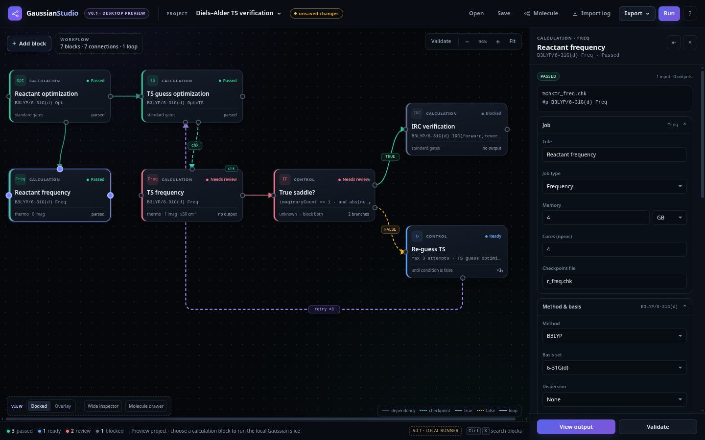

# NodeChem Studio

A desktop application for building and running computational-chemistry workflows as a graph. Place
calculation blocks on a canvas, connect them, and run one block or the whole workflow. Every run
writes a folder with the exact input, the raw output and a provenance record you can hash and share.

Two engines, one project at a time:

| Engine | Licence | Level of theory |
| --- | --- | --- |
| **Gaussian 16** | Commercial — licensed separately by Gaussian, Inc. | DFT and wavefunction methods with explicit basis sets |
| **xTB** (GFN0/GFN1/GFN2/GFN-FF) | Open source (LGPL) | Fast semi-empirical and force-field methods |

The app bundles neither engine. It drives an installation you already have, on the machine it is
installed on. Without either, the dry run exercises the whole pipeline on a labelled fixture.



**Status: v0.2.1 — early preview.** The graph, the durable workflow queue, the dry-run path, the
project format, the results surface, validity checks, the methods paragraph, run-bundle export, the
structure viewer and both engines' input builders and parsers are implemented and covered by tests.
What has *not* been proven is a real run: no licensed Gaussian job and no real xTB job has been
executed by the project's automated tests. Read [Current limitations](#current-limitations) before
you trust a result.

## What it does

- **Graph workflows** — calculation blocks, conditions, loops and joins, with dependency,
  checkpoint and branch connections.
- **A durable queue** — runs blocks in dependency order, survives a restart, and reconciles an
  interrupted task instead of calling it complete.
- **Two engines behind one contract** — Gaussian 16 job types down to `Opt=TS`, IRC and scans; xTB
  with GFN0/1/2 and GFN-FF, solvation, threads and restart hand-off.
- **Honest results** — gates answer "did it run", validity checks answer "is it defensible", and
  missing evidence is reported as `unknown` or `not reported`, never as a pass.
- **Provenance** — `run.json` records the exact input hash, the parsed output, the engine's method
  block and the app version; a run bundle adds `methods.md` and a per-file SHA-256 manifest.
- **Local only** — no account, no telemetry, no network code at all.

## Install

| Platform | How |
| --- | --- |
| Windows 10/11 x64 | Run `nodechem-studio-0.2.1-x64.exe` from the release. Per-user install, unsigned — SmartScreen warns once. |
| Linux x64 | `chmod +x nodechem-studio-0.2.1-x86_64.AppImage` and run it. Unsigned. |
| From source | Node 22+, then `npm ci && npm run dev`. |

Neither artifact installs Gaussian or xTB. See [Install](docs/guide/install.md) for the data
directory, requirements and the unsigned-build warning.

## First five minutes

1. Launch the app. The seeded Diels–Alder project opens with **Dry run (fixture output)** checked.
2. Select **Reactant frequency**, click **Run**, then **Run selected block**. No engine is needed.
3. Read the gate verdict and the results panel. A dry run is a labelled fixture, not a calculation.
4. Click **Run workflow** to watch the queue walk the graph, evaluate the condition and skip the
   branch it did not release.
5. **Save** to write a `.ncs` project.

[Your first project →](docs/guide/first-project.md) walks through it with the exact UI labels.

## Documentation

| Page | What it covers |
| --- | --- |
| [Documentation index](docs/guide/README.md) | Reading order and the reference pages |
| [Install](docs/guide/install.md) | Artifacts, requirements, data locations |
| [Your first project](docs/guide/first-project.md) | Dry run, workflow, own geometry, saving |
| [The canvas](docs/guide/canvas.md) | Blocks, connections, states, inspector |
| [Engines](docs/guide/engines.md) | Gaussian 16 vs xTB, job types, defaults, xTB setup |
| [Workflows](docs/guide/workflow.md) | Queue, conditions, loops, checkpoints, cluster export |
| [Results](docs/guide/results.md) | Gates, validity checks, thermochemistry, viewer, bundles |
| [Projects and runs on disk](docs/guide/project-files.md) | `.ncs` file, run folders, provenance |
| [Troubleshooting](docs/guide/troubleshooting.md) | Symptom → cause → action |
| [FAQ](docs/guide/faq.md) | Short answers |
| [Privacy and licensing](docs/guide/privacy-and-licensing.md) | What leaves the machine, and what the licence grants |

Normative references: [`docs/PROJECT-FORMAT.md`](docs/PROJECT-FORMAT.md) (the `.ncs` document and the
on-disk layout), [`docs/CLUSTER_EXPORT.md`](docs/CLUSTER_EXPORT.md) (SLURM/PBS export),
[`docs/IMPLEMENTATION_PLAN.md`](docs/IMPLEMENTATION_PLAN.md) (phased plan).

## Requirements

- **App:** Windows 10/11 x64, or a modern Linux x64 distribution. macOS runs from source; there is no
  packaged macOS build.
- **Real Gaussian run:** a licensed Gaussian 16 installation on the same machine and operating
  system. Windows uses the console `g16.exe`; Linux and macOS use `g16` with Link 1 (`l1`) beside
  it. A Windows licence does not authorise a Linux binary and may not be used under WSL.
- **Real xTB run:** an `xtb` executable (`xtb.exe` on Windows) plus its `share/xtb` parameters, or
  `XTBPATH` pointing at them. No licence file.
- **Building from source:** Node.js 22 or newer, npm 10 or newer.

No Gaussian binaries or licence files are included in this repository, in the installer, or in any
release artifact. No xTB binary is bundled either.

## Commands

| Command | Purpose |
| --- | --- |
| `npm run dev` | Vite + Electron development loop |
| `npm start` | Electron against `dist/` |
| `npm test` | Vitest unit and runner tests |
| `npm run check` | `node --check` on the Electron and shared modules |
| `npm run build` | Vite production renderer build |
| `npm run dist` | Vite build + NSIS installer (run on Windows) |
| `npm run dist:linux` | Vite build + unsigned AppImage (run on Linux) |
| `npm run bundle` | Source hand-off tarball/zip with a checksum manifest |

## Project layout

```
electron/          main process: dialogs, IPC, run manager, queue, engine runners
src/renderer/      graph canvas, inspector, run console, results and structure views
src/shared/        pure modules: input builders, parsers, schema, control flow, validity
src/shared/engines Gaussian and xTB descriptors, capabilities and canonical results
test/              Vitest suites, including engine fixtures
docs/              documentation; the user guide lives in docs/guide/
```

## Current limitations

- **No real Gaussian run has been recorded.** Preflight and the runner are covered by unit tests
  against fake executables, not against a licensed installation. The Windows acceptance run (GN-001)
  is still pending.
- **No real xTB run has been recorded in this checkout.** The builder, parser and fixture path are
  covered by tests; the end-to-end suite only runs when `XTB_BIN` points at a real binary.
- **No packaged macOS build.** The runner and preflight support macOS; there is no build to sign or
  test.
- **xTB validity checks are narrower than Gaussian's.** xTB has no route, basis or ECP to inspect, so
  the Gaussian-only checks are reported as *not applicable* (never as a pass). Charge/multiplicity,
  geometry sanity, imaginary modes and optimisation convergence are judged for both engines.
- **Output bundling is not implemented.** An Output bundle block stops the queue with a recorded
  reason; use **Export run bundle** on a finished run instead.
- **Join policy `any` still waits for every input.**
- **Validity thresholds are documented choices, not calibrated against real logs.** The `S**2`
  parsing and geometry heuristics need a real-log check.
- **The structure viewer is static.** The parser does not extract normal-mode displacements, so
  animation is unavailable rather than faked.
- **Periodic systems are out of scope.** No unit cells, k-points, band structures or plane-wave
  engines. A `.cif`, `.poscar`/`.vasp` or `.cell` file is refused with a message saying so, rather
  than being parsed as if its asymmetric unit were a molecule. Revisit only alongside a periodic
  engine backend (see [#66](https://github.com/xharl/nodechem-studio/issues/66)).
- **One engine process at a time.** No concurrent local scheduler; cluster execution happens by
  exporting scripts, not by submitting them.
- **Unsigned builds.** No auto-update, no crash reporting, no code signing.
- **No remote execution, submission, cloud API or telemetry.** This is intentional.

## Collaboration model

NodeChem Studio is **single-user and local**: no accounts, no server, no shared store. A project is
one `.ncs` file, and the app refuses to overwrite a file that changed on disk since it was opened
(hash check, with a message telling you to reopen or save under a new name).

Two people *can* work on the same project on a shared drive, reconciled rather than live-synced:

```
ncs diff theirs.ncs mine.ncs
ncs merge base.ncs mine.ncs theirs.ncs --out merged.ncs
```

The merge is structural, keyed by block id: edits to different blocks or different fields merge, and
overlapping edits are refused with a per-field conflict report (exit 5) instead of a silent
last-write-wins. See [Headless CLI](docs/guide/cli.md#collaborating-on-a-project).

## Safety and licensing

NodeChem Studio is free software under the **Apache License 2.0** (see [`LICENSE`](LICENSE)). That
licence covers this repository's code and documentation; it does not grant any right to
Gaussian, which is licensed separately by Gaussian, Inc.

- Gaussian is commercial and platform-bound. This project only drives an installation you are
  licensed to use on that machine.
- xTB is LGPL and, like Gaussian, is not bundled — you install it yourself.
- Dry run is the default. It produces a file headed `FIXTURE OUTPUT` and never claims to be a
  calculation.
- Run records stay under Electron's `userData` directory. No run data is uploaded.

Full detail: [Privacy and licensing](docs/guide/privacy-and-licensing.md).

## Contributing

Bug reports, corrected documentation and pull requests are welcome. Read
[`CONTRIBUTING.md`](CONTRIBUTING.md) first — it covers the build, the test gate and the rules that
keep the fixture/real-run distinction intact. Security reports go through
[`SECURITY.md`](SECURITY.md), not a public issue.

When you report a run problem, attach the run folder
(`%APPDATA%\nodechem-studio\runs\<runId>` on Windows, `~/.config/nodechem-studio/runs/<runId>` on
Linux) zipped, minus anything you are not licensed to share. The exact input, output and `run.json`
are what make a defect reproducible.

## Licence

[Apache License 2.0](LICENSE). Gaussian 16 is licensed separately by Gaussian, Inc.; nothing here
grants rights to it.
